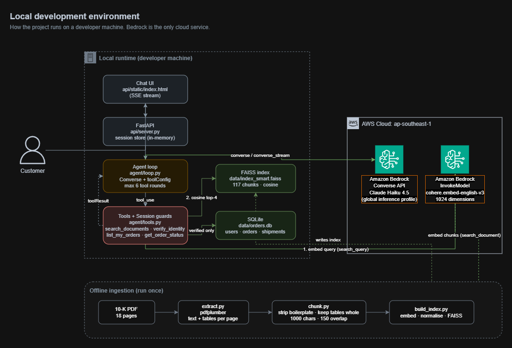
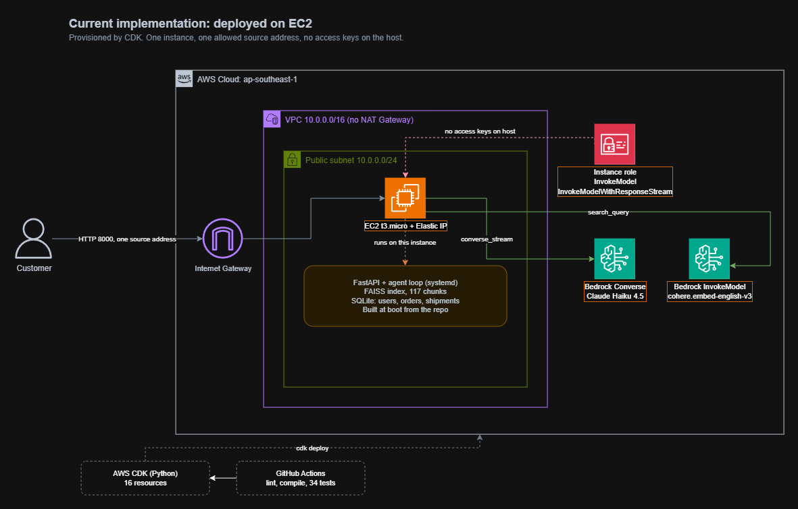
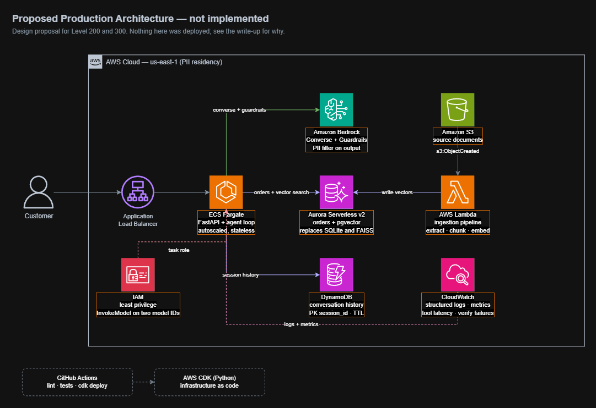

# CK Agent — Solution Engineer Intern Assignment

[](https://github.com/Kevinau38/ck-agent/actions/workflows/ci.yml)

Agentic conversational system for a US e-commerce company. Two capabilities:
RAG over an internal document, and an order-status workflow gated behind user
verification.

## Architecture

The system is presented in three states: how it runs locally, how it was
deployed to AWS, and where it should go at production scale.

### Local development



### Deployed on EC2



### Proposed production (design only)



Full technical write-up: [docs/SOLUTION.md](docs/SOLUTION.md)

## Stack

| Layer | Choice |
| --- | --- |
| Agent loop | Bedrock Converse API + `toolConfig` |
| Model | Claude Haiku 4.5 via global inference profile |
| Embedding | `cohere.embed-english-v3` on Bedrock |
| Vector store | FAISS, local flat index |
| Order data | SQLite |
| Web layer | FastAPI + SSE streaming |
| Region | `ap-southeast-1` |

## Setup (Windows, PowerShell)

```powershell
python -m venv .venv
.\.venv\Scripts\Activate.ps1
pip install -r requirements.txt
copy .env.example .env
```

If PowerShell blocks the activate script, run once:
`Set-ExecutionPolicy -Scope CurrentUser RemoteSigned`

Put the source PDF at `data\Company-10k-18pages.pdf`.

The virtual environment must be activated in every new terminal.

## Build (run once)

```powershell
python scripts\check_bedrock.py      # credentials, model access, embedding
python ingest\extract.py             # PDF to data\pages.json
python ingest\build_index.py         # build both FAISS indexes
python data\seed_db.py               # create the mock order database
```

`data\` holds generated artefacts and is gitignored, so a fresh clone must run
the four build steps above before the agent will start.

## Run

```powershell
python agent\loop.py                             # command line
python -m uvicorn api.server:app --reload --port 8000   # web at localhost:8000
```

## Test

```powershell
python scripts\test_verify.py        # 34 assertions on verification and access
python scripts\compare_retrieval.py  # retrieval quality, naive vs preprocessed
```

## AWS deployment

Infrastructure is defined as code with AWS CDK in Python. A single
`cdk deploy` creates 14 resources across network, security, and compute.

```powershell
cd infra
cdk deploy -c allowed_ip=<your-ip>/32
```

| Aspect | Design |
| --- | --- |
| Compute | EC2 t3.micro in a public subnet |
| Network | VPC with Internet Gateway, no NAT Gateway |
| Access | Security group restricted to one source address |
| Credentials | IAM instance role, no access keys on the host |
| Permissions | `bedrock:InvokeModel` and `InvokeModelWithResponseStream` only |
| Bootstrap | Application built from the repo at first boot |

The stack has been torn down with `cdk destroy` to avoid ongoing charges.

## Verification

Four credentials are collected before any order data is read: company email
matching `@ck<integer>`, full name, last 4 digits of SSN, and date of birth.

The brief specifies different field sets in two places, so all four are
collected to satisfy both readings. Email is the lookup key because it is the
only field with a stated format rule.

Values are accepted as typed. A full SSN is truncated to its last four digits
rather than rejected, and a date of birth is read in any format including a
sentence. Where a date is ambiguous, both readings are tried and either may
match, which is safe because verification compares against a value already on
file.

Verification state lives in `Session` in Python, never in the model context.
Every tool re-checks it, so no prompt wording can bypass a check.

## Why two indexes

`index_naive` splits the raw document on a fixed character window.
`index_smart` strips repeated page furniture, keeps tables whole, splits on
paragraph boundaries, and tags every chunk with its page number.

Both are built so retrieval quality can be measured rather than asserted.
See `docs\retrieval_comparison.md`.

## Cost

Total spend for the entire assignment: **USD 0.53**.

| Item | Cost |
| --- | --- |
| Claude Haiku 4.5 | $0.46 |
| Cohere embeddings | $0.01 |
| EC2 t3.micro | $0.01 |
| Tax | $0.05 |

Input to output token ratio was 28 to 1, because every tool round replays the
full conversation history. NAT Gateway and OpenSearch Serverless were avoided
by design, since both bill hourly with a floor.
